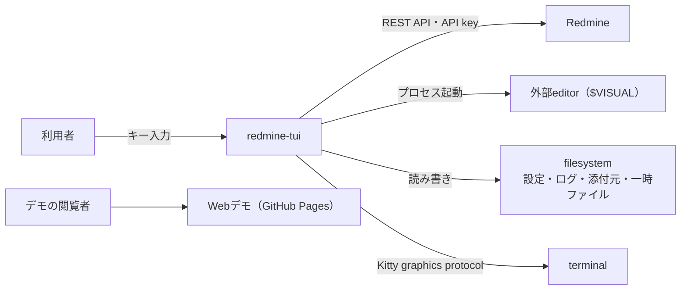
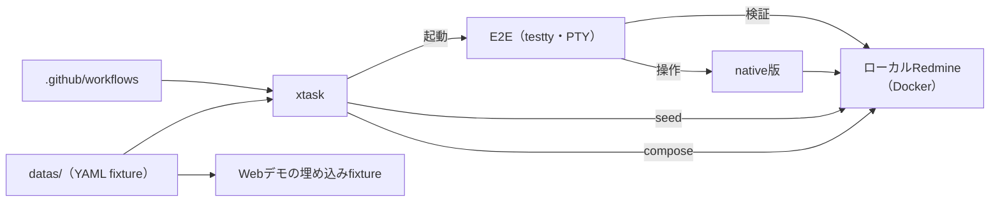
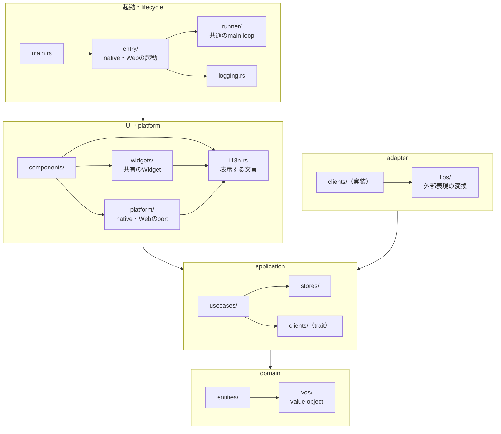
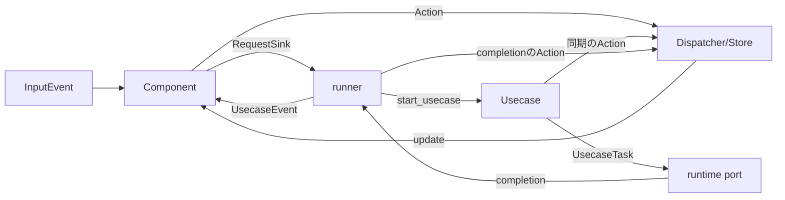

# アーキテクチャ

本リポジトリのContext、Container、ディレクトリをまたぐComponentの構造をまとめる。ディレクトリ内の構造は各モジュールの`//!`に置く。判断の経緯は`docs/adrs/`にある。

## Context

- Redmineとの間は楽観的に競合を検出する。保存の前にIssueを取得し直し、編集を始めた時点の値とサーバーの値が異なる属性やJournalを競合として利用者に選ばせる。サーバー側のロックは使わない。
- WebデモはRedmineに接続せず、埋め込んだfixtureをメモリ上で編集する。

### 用語

| 用語                       | 意味                                                                                                   |
| -------------------------- | ------------------------------------------------------------------------------------------------------ |
| 基準値                     | サーバーから最後に取得したIssueの値（`IssueAggregate`）。ローカルの編集では変えない。                  |
| diff                       | 1回の編集を表す`before`/`after`の組。編集した順に積み、表示値は属性ごとに最後のdiffの`after`で決まる。 |
| 表示値                     | 基準値にdiffを当てた値（`IssueView`）。                                                                |
| Synced / Edited / Uploading | Issue属性の状態。未編集、編集済み、保存中。Journalの状態は含まない。                                   |
| upload                     | ローカルの変更をRedmineへ保存する一連の処理。保存前の取得、PUT、確認の取得からなる。                   |
| 競合                       | 保存前の取得で、diffの`before`とサーバーの値が異なること。                                             |
| Remote Journal             | サーバーにあるJournal。notesを編集できる。                                                             |
| Local Journal              | まだ投稿していない新しいJournalの下書き。Issueごとに0件か1件。                                         |
| DeletedJournal             | 編集中に取得結果から消えたJournalの退避データ。                                                        |
| 子一覧                     | 詳細取得で得た子Issueの要約（`IssueChild`）の木。                                                      |
| マスターデータ             | 起動時に一度だけ取得するstatus、tracker、user等。起動後は更新しない。                                  |
| completion                 | 非同期の処理が終わったときにrunnerへ返る結果（`UsecaseOutput`）。                                     |

## Container

### プロダクト

| Container        | 実体                                     | 外部との関係                                                    |
| ---------------- | ---------------------------------------- | --------------------------------------------------------------- |
| native版         | `native` featureでbuildしたバイナリ      | RedmineへHTTP、editorをプロセス起動、filesystemを読み書き       |
| Webデモ          | `web-demo` featureとwasm32でbuildしたページ | ブラウザ上で動き、外部と通信しない                              |
| 設定ファイル     | `$XDG_CONFIG_HOME/redmine-tui/config.toml` | native版が起動時に1回読む                                       |
| ログ             | native版はファイル、Webデモはbrowser console | 書くだけ                                                         |
| 一時ディレクトリ | native版がプロセスごとに作り、終了時に消す | 取得した画像を書く                                              |

native版とWebデモは`src/`のほとんどを共有し、違いは起動処理と`src/platform/`のportに閉じ込める。

表示する文言は`locales/`の英語と日本語のメッセージカタログ（Fluentの`.ftl`）から引く。カタログはbuild時にバイナリへ埋め込み、native版とWebデモで共有する。言語はnative版が設定ファイルの`[ui] language`で起動時に1つ選び、Webデモは英語に固定する。

| port         | native                                | Web                       |
| ------------ | ------------------------------------- | ------------------------- |
| 入力         | crossterm                             | Ratzilla `DomBackend`     |
| Runtime      | Tokio                                 | `spawn_local`             |
| Redmine      | HTTP                                  | memory mock               |
| Editor       | external editor                       | textarea                  |
| Logging      | file                                  | browser console           |
| Cursor       | terminal cursor                       | cursor位置のセルをreverse |
| 画像表示     | Kitty graphics protocol（設定で有効） | 常に無効                  |
| 一時ファイル | プロセスごとの一時ディレクトリ        | 書かない                  |

### 開発・テスト環境

- `datas/`はWebデモとRedmine seederの共通の入力である。seederは`docker/redmine/fresh_test_data.sql`でデータベースを初期化してから`datas/`を投入し、`tests/redmine_seeder_files_test.sh`がこれらの対応を検査する。
- Redmine clientテスト（`container-tests`）とE2E（`e2e-tests`）はfeatureで分け、xtaskが起動した一時的なRedmineに対してだけ実行する。テストごとにseedを入れ直す。
- CIは単体テストとbuild、メッセージカタログの検査（`cargo xtask check-locales`）、Redmine clientテスト、E2E、Web buildを別のjobで実行する。Pagesへの配信とmutation testingは別のworkflowで行う。

## Component

### 層と依存

矢印は依存する側から依存される側への向き。上の層は下の層に依存してよく、逆はない。

- `usecases`は`components`に依存しない。ComponentはRedmineのUsecaseを直接呼ばず、`UsecaseRequest`でrunnerに起動を要求する。
- `clients`は`stores`にも`usecases`にも依存しない。実装は起動処理が組み立て、`UsecaseClients`としてrunnerに渡す。
- 共通層（components、widgets、stores、usecases、entities、vos）は、crossterm、Ratzilla、DOM、Tokio、filesystem、process、HTTP実装に直接依存しない。wasm32でbuildできない`ratatui-image`は`stores/terminal_image.rs`の型からだけ使う。

### データの流れ

Fluxを参考にした一方向のデータフローである。

- Storeは`Dispatcher`を介してだけ更新する。Store更新の通知はpub/subではなく、初期セットアップとeditor中を除き、runnerが`consume_action`のたびに`update`を呼ぶ。全Actionを消費してから1回だけupdateする作りではない。editor中はStoreへの反映だけを行い、Componentはeditorから戻った後に更新する。
- editor起動やRedmineとの通信などの外部副作用は、Componentが`RequestSink`に要求を書き、runnerが実行する。runtime handleやexecutorの型をComponent、Store、Clientに渡さない。
- Usecaseが一度だけ起きたことを伝えるときは`UsecaseEvent`を返し、runnerがそれを`AppComponent`へ渡す。購読者を登録する仕組みは持たない。
- focus、cursor、scrollなどの同期的なUI stateはStoreに置かず、Componentが持つ。

### 失敗に見える分岐の分類

StoreとUsecaseは、失敗やActionの不受理に見える分岐を次のように区別する。

- 異常系: 自プロセスの状態機械違反。`panic!`で止める。dispatchとconsumeの時点が離れていて、`Result`を返す先がないためである。
- 準異常系: 外部起因の復帰可能な失敗。messageをActionに載せて状態を戻し、`UsecaseEvent`を通じてtoastで知らせる。
- stale completion: 重複を許した非同期要求の追い越し。request IDの一致で判定して捨てる。
- マージ戦略: サーバーのデータを取り込むとき、ローカルの編集を守るために意図して適用しないこと。
- 冪等no-op: Action自体が冪等であるための正常なno-op。
